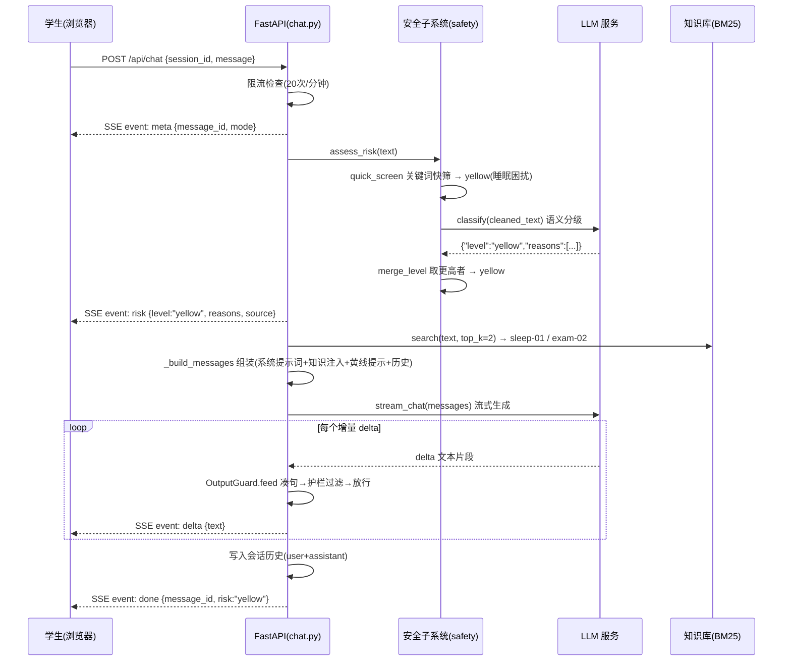
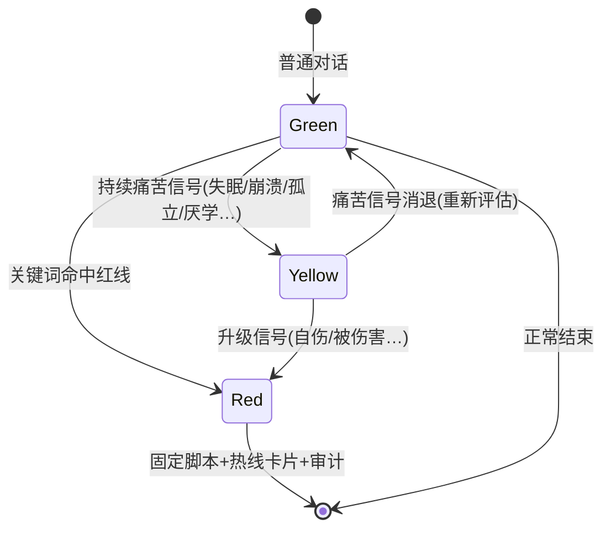

# 小树洞 · 技术文档

> **项目**：小树洞 —— 小学六年级学生心理陪伴智能体（居家网课 + 毕业升学双重压力场景）
> **文档版本**：v1.0 ｜ **更新日期**：2026-10-23 ｜ **文档状态**：与代码 `psy-companion` 主线保持一致
> **读者对象**：需要接手、评审、部署或二次开发本系统的工程师与架构师

---

## 0. 文档导读

### 0.1 这份文档是什么，不是什么

| 它是 | 它不是 |
|---|---|
| 面向工程师的系统技术文档：架构、数据流、安全机制、API 契约、测试与部署 | 产品需求文档（PRD）——产品定位与设计理念见《智能体设计作业-小树洞》 |
| 基于源码逐行核实后写成的"实现说明书"，所有数字与代码引用可对照验证 | 宣传材料——已知限制与生产化差距在第 12 章直面列出 |
| 一份"决策记录"：每个关键选择都说明理由与被否方案 | 教程——不逐步教你用 FastAPI，但给出可复用的工程范式 |

### 0.2 推荐阅读路径

| 你的角色 | 建议路径 |
|---|---|
| 架构评审者 | 第 2 章（架构与决策）→ 第 3 章（安全子系统）→ 第 12 章（限制与路线） |
| 后端开发者 | 第 4 章（对话管线）→ 第 6 章（知识库）→ 第 7 章（模型服务层）→ 第 9 章（API） |
| 前端开发者 | 第 5 章（多模态链路）→ 第 8 章（前端架构）→ 第 9 章（API 契约） |
| 测试 / 运维 | 第 10 章（测试体系）→ 第 11 章（部署与配置） |
| 课程答辩 / 评审老师 | 第 0.3 节速览 → 第 3 章（安全设计，本作品最核心的工程差异点） |

### 0.3 五分钟速览：十个关键结论

1. **一个内核，三个入口**：文字、语音、图片在前端统一为同一种 `Message` 结构，后端只有一条对话管线（`app/api/chat.py`），新增输入方式不改内核。
2. **安全是双引擎**：输入侧"关键词快筛（毫秒级）→ LLM 语义分级 → 取更高等级"；输出侧"提示词软约束 + 句级后置过滤硬约束"。
3. **红线不交给模型**：一旦判定红色，停止常规生成，直接流式输出写死在后端的安全脚本 + 12355/12356 热线卡片，并落审计日志。
4. **检索用 BM25 不用向量库**：66 篇稳定知识，jieba 分词 + BM25（k1=1.5, b=0.75）内存检索，零依赖、可解释、可审计；得分低于 0.8 不注入。
5. **全链路流式**：`POST /api/chat` 返回 SSE 事件流 `meta → risk → delta* → suggestions? → done`，逐字输出且每句话都过护栏。
6. **无 Key 也能跑**：没有配置模型 Key 时自动降级 mock 演示模式，界面与全链路（含分级、检索、限流）真实运行，只是回复为预置安全话术。
7. **密钥分三层边界**：服务端 `.env`（默认）→ 请求级本机 Key（一次性服务，不落盘）→ 前端 localStorage（仅存本机浏览器）。
8. **会话在内存，接口为生产预留**：`SessionStore` 现为进程内实现（TTL 1 小时、12 轮 / 6000 字符窗口），换 Postgres 不改接口。
9. **测试 33 个函数、参数化展开 50+ 条**：覆盖安全词库、护栏、会话、知识库、API 集成与模型服务；另有 3 个浏览器端到端脚本（Edge）。
10. **已知最大短板**：单实例内存会话（重启丢失）与图片内容审核依赖模型自身判断——生产化路线见第 12 章。

---

## 1. 系统总览

### 1.1 产品一句话

一个 11~12 岁学生随时可以说话、不评判、能兜住风险的 AI 陪伴者：围绕**考试压力**与**升学焦虑**，提供文字、语音、图片三种对话方式，内置三级危机预警与"四不"输出护栏。

> 系统在首轮对话即声明："我是 AI，不是真人，也不能代替心理老师；聊天内容会保密，但如果涉及安全，我会建议你告诉信任的大人。"

### 1.2 要解决的真实问题

| 用户特点 | 含义 | 产品对应设计 |
|---|---|---|
| **说不清** | 情绪词汇有限，常说"烦""难受" | 回应先接住感受、帮他把情绪命名，再给方法 |
| **不敢说** | 怕被说"矫情"、怕被当"问题学生" | 匿名会话、不评判、四不护栏 |
| **不愿找真人** | 同伴缺席、深夜无人可诉 | 7×24 可用的 AI 第一响应人，最终引向大人与热线 |

设计依据三份政策文件：《中小学心理健康教育指导纲要（2012 年修订）》《进一步加强中小学生心理健康工作十条措施》（2025）《健康中国行动——儿童青少年心理健康行动方案（2019—2022 年）》。每一条提示词规则都能对应到政策条款（详见设计作业文档 1.4 节）。

### 1.3 关键数字

| 指标 | 数值 | 说明 |
|---|---|---|
| 知识库规模 | 66 篇 Markdown | 12 个分类：政策 4、考试 8、升学 8、情绪 8、方法 8、亲子 6、同伴 6、危机 3、疫情 3、学习 4、睡眠 4、自我 4 |
| 后端代码 | 约 1,660 行 Python | `app/` 下 13 个模块（不含 `__init__.py`） |
| 前端代码 | 约 2,290 行 | 6 个 ES Module JS（1,170 行）+ 3 个 CSS（894 行）+ 1 个 HTML，零构建、零框架 |
| 测试 | 33 个测试函数 / 50+ 条用例 | 5 个测试文件，含参数化展开 |
| 危机词库 | 红线 8 组 + 黄线 8 组 + 习语剔除 24 条 | `app/core/lexicon.py` |
| 上下文窗口 | 12 轮 / 6000 字符 | 会话 TTL 1 小时 |
| 限流 | 20 次 / 分钟 / 会话 | 第 21 次返回 429 + 友好文案 |
| 检索阈值 | BM25 ≥ 0.8 才注入 | top-2 片段进入上下文 |

### 1.4 技术栈与选型理由

| 层 | 选型 | 选它而不是…（因为） |
|---|---|---|
| Web 框架 | FastAPI 0.158.2 | 原生 async + 自动 OpenAPI + Pydantic 校验；比 Flask 更适合流式场景 |
| ASGI 服务器 | uvicorn 0.54.0 | FastAPI 生态标配，`uvicorn[standard]` 自带 websockets/httptools |
| 模型客户端 | openai 3.36.0（AsyncOpenAI） | 所有 provider（智谱/百炼/硅基流动）都提供 OpenAI 兼容端点，一个客户端通吃 |
| 数据校验 | pydantic 2.14 + pydantic-settings 2.16 | 请求模型与 `.env` 配置同一套体系，类型安全 |
| 分词 | jieba 0.42.1 | 中文分词事实标准，纯 Python 无编译依赖 |
| 检索 | 自实现 BM25（检索模块共 140 行） | 66 篇规模不值得引入检索框架；自实现可解释、可测试 |
| 前端 | 原生 ES Modules + 手写 CSS | 演示/答辩环境一个 `python server.py` 就跑起来，不需要 Node 工具链 |
| 部署 | 单进程一体化（API + 静态文件同端口） | 托管环境只需暴露一个端口；无跨域、无构建步骤 |

---

## 2. 总体架构

### 2.1 架构分层

```
┌─────────────────────────────────────────────────────────────┐
│  前端（frontend/，原生 ES Modules，零构建）                     │
│  app.js 编排 │ api.js SSE 客户端 │ ui.js 渲染 │ voice.js 录音  │
│  image.js 压缩 │ settings.js 本机 Key                          │
└───────────────────────┬─────────────────────────────────────┘
                        │ HTTPS / SSE
┌───────────────────────▼─────────────────────────────────────┐
│  FastAPI 单进程（app/main.py，API 与静态前端同端口）            │
│  ┌──────────────┐ ┌───────────────┐ ┌────────────────────┐  │
│  │ api/chat.py  │ │ core/ 安全子系统│ │ knowledge/ 检索引擎 │  │
│  │ SSE 编排     │ │ lexicon 快筛   │ │ jieba + BM25       │  │
│  │ 限流/重试    │ │ safety 分级+护栏│ │ 66 篇内存索引       │  │
│  │ ASR/TTS 端点 │ │ sessions 会话  │ │                    │  │
│  │              │ │ audit 审计     │ │                    │  │
│  └──────┬───────┘ └───────────────┘ └────────────────────┘  │
│         │                                                    │
│  ┌──────▼───────────────────────────────────────────────┐   │
│  │ services/llm.py —— OpenAI 兼容客户端（多 Provider）     │   │
│  │ services/asr.py + tts.py —— 语音链路（可切独立 Key）    │   │
│  └──────┬───────────────────────────────────────────────┘   │
└─────────┼───────────────────────────────────────────────────┘
          │ OpenAI 兼容协议
   ┌──────┴──────┬──────────────┬────────────────┐
   ▼             ▼              ▼                ▼
 对话/分级模型   视觉模型(VLM)   ASR 模型        TTS 模型
 （可换厂商）    （图片理解）   （语音转文字）   （文字转语音）
```

模块职责一句话表：

| 模块 | 职责 | 关键点 |
|---|---|---|
| `app/main.py` | 应用工厂 + 启动预热 + 健康检查 + 静态托管 | lifespan 预热知识库，避免首请求冷启动 |
| `app/api/chat.py` | SSE 编排中枢：限流、分级、红线分支、消息组装、流式生成、ASR/TTS 端点 | 全系统最核心的 363 行 |
| `app/core/lexicon.py` | 危机词库与关键词快筛 | 习语先剔除再匹配，防"笑死我了"误报 |
| `app/core/safety.py` | 三级分级编排 + 输出护栏（句级） | 分级异常保守按黄线 |
| `app/core/sessions.py` | 内存会话仓库 | TTL + 轮次 + 字符双预算裁剪 |
| `app/core/audit.py` | 审计日志（JSONL） | 只记事件不记原文，会话指纹不可反推 |
| `app/core/prompts.py` | 全部系统提示词与危机脚本 | 与作业文档第三节逐字一致 |
| `app/knowledge/retriever.py` | 分词 + BM25 索引 + 检索 | 启动时全量加载 66 篇 |
| `app/services/llm.py` | 对话/分级/视觉客户端 + mock | thinking 开关按厂商适配 |
| `app/services/asr.py` / `tts.py` | 语音识别 / 合成 | 百炼走私有协议，其余走 OpenAI 兼容 |
| `app/config.py` | 配置体系 | `.env` + 请求级覆盖 + 语音独立 provider |

### 2.2 一次对话的完整旅程

以学生发送"我最近天天睡不着，一想到考试就想哭"为例（预期：黄线）：



红线路径（如"我不想活了"）在第 3.3 节单独展开——它在 `risk` 事件之后直接走固定脚本，不经过生成模型。

### 2.3 核心设计决策（ADR 速览）

完整理由分散在各章节，此处先给总表：

| # | 决策 | 选择 | 被否方案 | 核心理由 |
|---|---|---|---|---|
| 1 | 服务形态 | 单 FastAPI 进程托管 API + 静态前端 | 前后端分离双服务 | 一个端口、零跨域、一条命令启动；规模上来再拆 |
| 2 | 输入分级 | 关键词快筛 + LLM 语义分级，取更高 | 只用 LLM 分级 | 关键词毫秒级零成本可审计；LLM 兜住"想消失"类变体 |
| 3 | 红线响应 | 后端写死固定脚本 + 热线卡片 | 让模型生成危机回应 | 安全内容不能靠概率生成；固定脚本可测试、可审计 |
| 4 | 输出安全 | 提示词软约束 + 句级后置过滤 | 只靠提示词约束 | 模型可能幻觉/被诱导，硬约束是最后一道防线 |
| 5 | 知识检索 | jieba + BM25 内存索引 | 向量检索（embedding + 向量库） | 66 篇稳定内容，零依赖零成本可解释；心理场景检索误差代价高 |
| 6 | 会话存储 | 进程内存（接口预留） | 直接上数据库 | MVP 演示够用；`SessionStore` 接口与实现分离，换 Postgres 不动上层 |
| 7 | 流式协议 | SSE | WebSocket | 对话是单向流，SSE 走普通 HTTP，网关/重试/缓存策略都现成 |
| 8 | 无 Key 策略 | 自动降级 mock 演示模式 | 无 Key 直接报错 | 演示、答辩、测试不断链；界面右上角明示"演示模式" |
| 9 | 密钥入口 | 服务端 .env + 请求级本机 Key | 只有服务端 Key | 老师同学填自己的 Key 即可体验真实模型，服务端零改动 |
| 10 | TTS 接口 | 同步 + 异步 job 双接口 | 只有同步接口 | 部署网关有 15 秒上限，慢模型必须异步化 |

---

## 3. 安全子系统（核心章节）

这是本系统与"随便做个聊天机器人"的本质区别。安全设计的目标不是"模型一般不会说错话"，而是**即使模型说错话，也一定有东西兜住**。

### 3.1 威胁模型：我们在防什么

| 风险 | 场景 | 防线 |
|---|---|---|
| R1 漏报危机信号 | 学生说"想消失""撑不下去了"（不含关键词） | LLM 语义分级兜底 + 就高不就低 |
| R2 误报危机信号 | "笑死我了""累死了"触发"死"类规则 | 口语习语先剔除再匹配（第 3.2 节） |
| R3 模型输出诊断/用药 | 幻觉或被诱导说出"你这是抑郁症""吃点药" | 句级后置过滤，严重违规整句替换（第 3.4 节） |
| R4 红线时刻模型掉线 | 分级服务超时/5xx | 分级异常保守按黄线；红线判定不依赖网络 |
| R5 隐私泄露 | 审计日志暴露对话原文 | 只记事件类型 + 会话指纹（不可反推 session_id） |
| R6 学生索要身份信息/照片 | 对话中诱导 | 系统提示词明令禁止 + 图片隐私提醒 |
| R7 滥用/刷接口 | 恶意高频请求 | 每会话 20 次/分钟滑动窗口限流 |

### 3.2 输入侧：三级风险分级

分级管线（`app/core/safety.py: assess_risk`）：

```
用户输入
   │
   ▼
① 口语习语剔除（lexicon._strip_idioms）
   "笑死我了" → "□□□"（等长占位，防误报）
   │
   ▼
② 关键词快筛 quick_screen（毫秒级，零成本）
   红线 8 组规则：自杀/轻生/自伤/具体方式/告别计划/伤害他人/性侵害/家暴虐待…
   黄线 8 组规则：强烈痛苦/自我否定/被欺凌孤立/睡眠困扰/厌学/家庭安全/家庭冲突/考试升学焦虑
   │
   ├─ 命中红线 → 直接返回 red（不再调 LLM，省一次调用）
   ├─ 命中黄线 → 与 LLM 结果合并
   └─ 全绿且触发了习语剔除（cleaned≠原文）→ 直接返回 green（省一次调用）
   │
   ▼
③ LLM 语义分级 llm.classify（temperature=0，只输出 JSON）
   兜住"想消失""撑不下去了""我是多余的"等无关键词变体
   │
   ▼
④ merge_level(a, b) 取更高者 —— 宁可高估，不可低估
```

**词库设计细节**（`app/core/lexicon.py`）：

- 红线规则覆盖八类表达：自杀相关（`自杀|轻生|自尽|结束生命`）、轻生念头（`想死|死了算了|活着没意思|不想活|活不下去`）、自伤行为（`自残|割腕|划手|伤害自己`）、具体方式（`跳楼|跳河|上吊|喝农药|吞药`）、告别/计划（`遗书|写好告别`）、伤害他人、性侵害、家暴虐待。
- 黄线规则覆盖八类信号：强烈痛苦（`崩溃|绝望|撑不下去`）、自我否定（`我是废物|没人喜欢我`）、被欺凌孤立、睡眠困扰、厌学、家庭安全（`不想回家|离家出走`）、家庭冲突、考试升学焦虑。
- **习语剔除是防误报的关键**：24 条口语模式（`笑死|累死|困死|死党|死机|想死你了|拼命学习…`）先替换为等长占位符 `□`，再跑规则匹配。等长替换保证不影响后续任何位置计算。
- **短路优化**：命中红线不再调 LLM（红线判定完全本地确定）；全绿但发生过习语剔除也不再调 LLM（"笑死我了"这类已可确定安全）——既省钱又避免模型把"想死你了"误判为轻生。

**LLM 分级的设计**（`app/services/llm.py: classify`）：

- 专用分级提示词（`RISK_CLASSIFIER_PROMPT`），temperature=0 求确定性，max_tokens=300，只要求输出 `{"level":"green|yellow|red","reasons":[...]}`。
- 解析容错：`_parse_risk_json` 用正则 `\{.*\}` 提取，容忍 ```json 代码块包裹与多余文字；level 不在枚举内或 JSON 损坏 → 返回 `None`。
- 返回 `None` 时调用方回退到关键词结果（`assess_risk` 第 39-40 行）——**任何一步失败都向更安全的方向退化**。
- 输入截断 1500 字符，控制 token 成本。
- 当 LLM 把关键词的 green 升级为 red 时，写 `risk_escalated_by_llm` 审计事件——这正是语义分级在兜底的证据，可回溯统计。

### 3.3 红线路径：固定脚本，不交给模型

`chat.py` 第 143-152 行，一旦 `level == "red"`：

1. 写审计 `crisis_red`（会话指纹 + 命中原因）；
2. 把用户消息写入会话历史（后续对话仍有上下文）；
3. **不调用生成模型**，直接按 22 字/块流式吐写死的 `CRISIS_SCRIPT`（共情 → 不评判 → 建议告诉信任的大人 → 12355/12356 → 安全提示 → 开放结尾）；
4. 下发 `suggestions` 事件：两张热线资源卡片（12355 青少年服务台 / 12356 全国心理援助热线 24 小时）；
5. `done` 事件带 `crisis: true`，前端渲染 crisis 样式。

**为什么写死而不是让模型生成？** 危机回应是安全关键内容：模型生成有概率波动（temperature、上下文干扰、越狱尝试），而固定脚本① 每次一字不差，可被测试断言（`tests/test_safety.py` 有对应用例）；② 内容经过人工设计与政策核对；③ 可分块流式输出，用户体验不打断。**这是安全设计，不是技术选择。**

### 3.4 输出侧：四不护栏

提示词是**软约束**（`SYSTEM_PROMPT` 的"四不原则"：不诊断、不开药、不承诺、不评判），句级后置过滤是**硬约束**——模型被诱导或幻觉时，硬约束兜底。

`guard_output`（`app/core/safety.py: 71-89`）两类规则：

| 类型 | 命中行为 | 覆盖内容 |
|---|---|---|
| 严重违规（`_SEVERE_RULES`，5 条） | **整句丢弃**，替换为固定安全句 `FALLBACK_SENTENCE` | 疑似诊断（`你得了抑郁症`、`你这是心理问题`）、药物建议（`吃点药`、`剂量`、`毫克`） |
| 一般违规（`_SOFT_RULES`，3 条） | **短语替换**为安全表达 | 否定感受（`别想太多`→`这些感受值得被认真对待`）、绝对化承诺（`你一定能考上`→`尽力就好`）、评判家长老师（`你爸妈太过分`→`这件事让你很难受`） |

**流式实现 `OutputGuard`**（`safety.py: 92-146`）：

```
模型 delta 流 → 缓冲区
   ├─ 遇到句读（。！？!?；;\n）→ 切出一句 → guard_output → 放行/替换
   ├─ 缓冲超过 90 字（模型不打标点的极端情况）→ 强制切分过滤
   └─ 流结束 flush() → 剩余部分过一遍
```

设计要点：

- **句级而非整段**：流式体验优先，一句话过长时用户已经在读了；90 字强制切分兜底无标点输出。
- **严重违规只兜底一次**（`_fallback_emitted`）：同一轮回复连续多句严重违规时，只替换第一句，避免整段变成复读机——其余严重句直接丢弃（返回空）。
- 每次违规写 `output_violation` 审计（含 `severe` 标记），可在 `logs/audit.jsonl` 统计模型"变坏"的频率。

### 3.5 审计与隐私设计

| 原则 | 实现 |
|---|---|
| 只记事件，不记原文 | `log_event` 只接受结构化字段（event 类型、session 指纹、reasons、violations），任何调用点都不传对话文本 |
| 指纹不可反推 | `session_fingerprint = sha256(session_id)[:12]`，单向哈希，拿到日志也推不回原始会话 ID |
| 审计失败不阻塞对话 | `audit.py` 整个写入包在 `try/except OSError` 里，磁盘故障时静默跳过 |
| 匿名会话 | `session_id` 前端生成的 24 位随机 ID，不收集姓名、学校、电话；提示词明令禁止索要身份信息 |

审计事件类型一览：`crisis_red`（红线触发）、`risk_escalated_by_llm`（LLM 升级分级）、`output_violation`（输出护栏命中，含 severe）、`llm_error`（模型流式失败）、`empty_reply`（空回复兜底）。

### 3.6 安全状态机总览



两条不可绕过的铁律：**红线一旦到达，必经固定脚本**（生成模型被旁路）；**任何组件失败，分级向更安全方向退化**（LLM 挂了 → 按关键词结果；关键词+LLM 都异常 → 保守按 yellow）。

---

## 4. 对话管线

### 4.1 SSE 事件协议

`POST /api/chat` 返回 `text/event-stream`，事件序列固定：

```
event: meta        → {session_id, message_id, mode}      # 立即下发，前端先拿到消息 ID
event: risk        → {level, reasons, source}            # 分级结果，前端渲染风险条
event: delta       → {text}                              # 0..N 个增量文本块
event: suggestions → {cards}                             # 可选，红线时的热线卡片
event: done        → {message_id, risk, crisis?, failed?} # 收尾
```

响应头三件套：`Cache-Control: no-cache`、`Connection: keep-alive`、`X-Accel-Buffering: no`（最后一个是给 Nginx 类反代关缓冲的，没有它流式会被网关攒成整段）。

前端用 `fetch` + `res.body.getReader()` 手写解析（`frontend/js/api.js`），按 `\n\n` 切块、解析 `event:`/`data:` 行——不依赖 EventSource（POST + SSE 场景 EventSource 不支持）。

### 4.2 提示词组装：顺序即优先级

`_build_messages`（`chat.py: 70-101`）按固定顺序拼装 messages 数组：

| 顺序 | 内容 | 条件 |
|---|---|---|
| 1 | 系统人格提示词 `SYSTEM_PROMPT` | 总是 |
| 2 | 图片引导提示词 `IMAGE_GUIDE_PROMPT` | 图片消息 |
| 3 | 知识注入 `KNOWLEDGE_INJECT_TEMPLATE` | 文字/语音消息且检索有命中 |
| 4 | 黄线提示 `YELLOW_HINT_TEMPLATE` | level == yellow |
| 5 | 会话历史（已裁剪） | 总是 |
| 6 | 当前用户消息 | 总是 |

三个值得注意的工程决策：

- **图片消息不检索知识库**：图片走视觉模型理解画面，文本检索对"一张试卷照片"没有意义（`chat.py: 80`）。
- **风险等级通过系统消息注入而非改人格提示词**：黄线时插入"内部提示，不要直接说出来：当前风险等级 yellow…请更温柔地探询"——提示词分层，人格稳定。
- **参考资料要求"自然融入、不逐字照搬、不说'根据资料'"**：避免客服腔，六年级孩子不听这个。

### 4.3 会话与上下文窗口

`SessionStore`（`app/core/sessions.py`）：

- 存储：`dict[session_id, Session]`，`threading.Lock` 保护（FastAPI 多 worker/线程场景）；
- 数据结构：每会话一个 `deque[Turn]` + `risk_level` + `turn_count` + 时间戳；
- TTL：1 小时无活动即清理（`_cleanup_locked` 在每次 `get_or_create` 时惰性执行）；
- 双预算裁剪（`history()`）：**倒序**累加消息，超过 6000 字符即停——保证窗口里永远是最近的对话；同时按 12 轮（24 条消息）硬截断。

> 生产替换路径：把 `SessionStore` 换成 Postgres 实现（表：`sessions` / `turns`），`get_store()` 工厂函数改注入，上层零改动——这是接口预留的意义。

### 4.4 限流、重试与兜底

| 机制 | 实现 | 理由 |
|---|---|---|
| 限流 | 每会话 `deque` 滑动窗口，60 秒内超过 20 次 → 429 | 防刷接口烧 token；文案"说得有点快啦，让系统歇口气"保持人设 |
| 流式重试 | 生成异常时，**一个字符都没吐出**才重试一次（间隔 0.5s） | 已吐出一半时重试会产生"复读"；首次重试专门应对偶发超时/5xx |
| 分级异常 | `assess_risk` 抛异常 → 保守按 yellow + `source: "fallback"` | 宁可多温柔一次，不可漏掉危机 |
| 检索异常 | 检索失败只 warning，对话继续（无参考资料） | 检索是增强不是依赖 |
| 空回复兜底 | 思考型模型可能把 token 全用在推理上 → 正文为空 → 固定文案兜底 + `empty_reply` 审计 | 不能把空消息写进会话历史 |
| 友好错误文案 | `friendly_error` 把欠费/Key 失效/超时/网络错误翻译成孩子能看懂的话 | "模型账户需要充值，请让老师处理一下"而不是一行 401 堆栈 |

---

## 5. 多模态链路

### 5.1 三入口归一化

前端三种输入最终都变成同一个 `ChatMessage`（`app/models.py`）：

```python
class ChatMessage(BaseModel):
    type: Literal["text", "voice", "image"] = "text"   # 消息溯源
    content: str                                        # 文字/语音转写结果/图片描述
    image_data_url: Optional[str]                       # 仅图片：压缩后的 data URL
    llm_config: Optional[LLMConfig]                     # 可选本机 Key
```

- 语音：按住说话 → MediaRecorder 录音 → `POST /api/asr` 转写 → **转写结果可编辑错字再发送**（转写错了能改，这点对孩子很重要）；
- 图片：本地 canvas 压缩（最长边 1200px、JPEG 0.82）→ data URL 随消息上传；
- 后端 `_user_content` 只对图片消息构造多模态数组 `[{type:text},{type:image_url}]`，文字/语音是纯文本——**一条管线，三种入口**。

### 5.2 语音识别（ASR）

链路：浏览器 MediaRecorder（MIME 协商：webm/opus → mp4 → ogg，取第一个支持的）→ base64 data URL → `POST /api/asr` → 服务端 `decode_audio` 解码 → `transcribe`：

| Provider | 走法 |
|---|---|
| 阿里云百炼（`qwen3-asr-flash`） | 私有 multimodal-generation 端点（urllib 同步调用，`asyncio.to_thread` 包成异步） |
| 其他（硅基流动 Qwen3-ASR 等） | OpenAI 兼容 `client.audio.transcriptions.create` |

边界：音频上限 6MB（`asr_max_bytes`）、空音频 400、识别为空 422"没有听清，再说一次吧"、失败 502 + 友好文案。硅基流动 Qwen3-ASR-1.7B 实测约 1 秒。

### 5.3 语音合成（TTS）

**双接口设计**是这条链路最值得讲的工程点：

| 接口 | 用途 |
|---|---|
| `POST /api/tts`（同步） | 本地/短文本，直接拿音频字节 |
| `POST /api/tts/jobs` + `GET /api/tts/jobs/{id}`（异步） | **线上默认**：立即返回 job_id，`BackgroundTasks` 后台合成，前端轮询（202=生成中，200=音频，502=失败） |

为什么必须异步：部署环境的网关有 15 秒请求上限，而 CosyVoice2 合成可能更慢——同步接口会在网关层被掐断。job 表 5 分钟 TTL 自动回收，取到音频后即从表里删除。

其他细节：合成文本截断 300 字（`tts_max_chars`）；语速 0.85（比默认慢 15%，实测听感更温柔，匹配"耐心大哥哥/大姐姐"人设）；音色 claire；百炼走 multimodal-generation 端点，其余走 `/v1/audio/speech`。

### 5.4 图片理解

- 压缩在浏览器端做（`frontend/js/image.js`）：FileReader → canvas 缩放 → toDataURL，**服务端不存原图**；
- 后端 `image_data_url` 字段上限 8MB（Pydantic 校验）；
- 走 `vlm_model`（如 Qwen3-VL-8B-Instruct），system 层追加 `IMAGE_GUIDE_PROMPT`：先温和描述看到的（不评判），再问和感受有关的问题；**不评价分数**；含人脸/姓名提醒遮挡；血腥暴力色情内容不细看、温和带回感受；
- 已知限制：① 图片内容审核目前依赖模型自身判断（提示词约束）；② **图片消息只按文字说明参与风险分级**——画面本身不过快筛与 LLM 分级（`chat.py:130` 只传 `message.content`），无说明的自伤照片不会触发红线。生产建议接入专业内容安全服务（见第 12 章 P1）。

---

## 6. 知识库与检索

### 6.1 选型决策：为什么是 BM25，不是向量 RAG

| 维度 | BM25（选用） | 向量检索（暂不选） |
|---|---|---|
| 依赖 | jieba + 自实现 BM25（140 行），零外部服务 | embedding 模型 + 向量库（pgvector/Milvus） |
| 成本 | 无推理成本，索引在内存 | 每次查询一次 embedding 推理 |
| 可解释性 | 命中了哪些词、得分多少，完全可审计 | 相似度黑盒 |
| 适配规模 | 66 篇、内容稳定，毫秒级 | 成千上万篇才体现优势 |
| 失败代价 | 心理场景检索误差 = 不安全的话术注入，**可控比先进更重要** | 语义漂移难以人工核对 |

结论不是"向量检索不好"，而是"这个阶段 BM25 是更优解"。等知识库过千篇、内容频繁更新，再换 embedding——检索层已被 `KnowledgeBase.search()` 接口封装，替换不伤上层。

### 6.2 索引与分词

- 加载：启动时（FastAPI lifespan 预热）扫描 `app/knowledge/docs/*.md`，66 篇全量入内存索引；
- 标题处理：每篇取第一个 `# ` 行作标题，**标题与正文合并分词**（标题是强信号）；
- 分词（`tokenize`）：`jieba.lcut` 精确模式 → 去标点（正则）→ 去 33 个停用词 → **去单字噪声**（单字且非 ASCII 直接丢弃，中文单字信息量低还会稀释 BM25）；
- IDF 预处理：`add` 时统计每篇的词频与文档频率 `df`，平均文档长度滚动更新。

### 6.3 BM25 实现要点

标准 BM25（`retriever.py: 65-89`），k1=1.5、b=0.75：

```
score(doc, query) = Σ_{term ∈ query} idf(term) · tf·(k1+1) / (tf + k1·(1 − b + b·|doc|/avgdl))
idf(term) = log(1 + (N − df + 0.5)/(df + 0.5))      # Lucene 变体，保证非负
```

- 逐文档线性打分（66 篇的规模，毫秒级，无需倒排索引优化）；
- 查询侧同样过 `tokenize`——去标点、去停用词、去单字噪声后再逐词打分，保证查询与文档在同一套词表上比较；
- 阈值 0.8：低于阈值不注入，**宁可少给参考资料，也不给不相关内容**；
- 对话管线取 top-2，每条截取 260 字符 snippet，以 `【标题】片段` 形式拼进 `KNOWLEDGE_INJECT_TEMPLATE`。

### 6.4 检索验证

`tests/test_knowledge.py` 对 6 组典型表达做 top-1 命中断言，全部通过：

| 用户表达 | top-1 命中 | BM25 得分 |
|---|---|---|
| 考试前睡不着怎么办 | exam-02-考前一晚睡不着 | 7.74 |
| 怕上初中跟不上 | upgrade-02-怕初中跟不上 | 8.50 |
| 被同学孤立了 | peer-01-被同学孤立 | 8.07 |
| 作业一拖再拖 | study-03-作业拖拉 | 7.86 |
| 朋友说不想活了 | crisis-02-朋友说不想活了 | 4.17 |
| 网课好孤单 | pandemic-01-网课孤单 | 3.90 |

---

## 7. 模型服务层

### 7.1 一个客户端，多 Provider

`LLMService`（`app/services/llm.py`）基于 `AsyncOpenAI`，通过 `base_url` 切换：

| 场景 | base_url | 对话模型 | 视觉模型 |
|---|---|---|---|
| 硅基流动（线上默认） | `api.siliconflow.cn/v1/` | GLM-4.5-Air | Qwen3-VL-8B |
| 阿里云百炼 | `dashscope.aliyuncs.com/compatible-mode/v1` | qwen-flash 等 | qwen3-vl-plus |
| 智谱 GLM | `open.bigmodel.cn/api/paas/v4/` | glm-5 | glm-4v-plus |

三个真实踩过的坑（.env.example 注释里有记录）：

1. **百炼必须带 `compatible-mode`**，漏掉直接 404；
2. **思考型模型必须给足 max_tokens**——glm-5.3 系列"始终思考"且关不掉，token 全被推理占空会导致正文为空（所以有空回复兜底，见 4.4）；
3. **thinking 参数各家格式不同**：百炼/硅基流动用 `{"enable_thinking": false}`，智谱用 `{"thinking": {"type": "disabled"}}`，不支持的端点用 `off` 干脆不发这个参数。

### 7.2 mock 模式：没有 Key 也能跑通全链路

设计目标：**降级不降功能**。无 Key 时（`llm_mode=auto` 且 Key 为空，或强制 `mock`）：

- `LLMService._client = None` → `is_mock=True`，对话走 `_mock_stream`；
- mock 回复由 9 类话题模板（毕业/睡眠/厌学/成绩/升学/父母/同伴/考试/默认）+ 首轮自我介绍生成，按句切片 + 20ms 间隔吐出，**流式形态与真实模式一致**；
- 话题路由用 `_TOPIC_PATTERNS` 正则（与词库同思路，轻量确定）；
- 同输入 → 同输出（`random.Random(hash(text))` 固定种子），保证测试可复现；
- 分级在 mock 下走关键词结果（`classify` 返回 None）——**分级能力不依赖模型，红线在 mock 模式依然生效**；
- 界面右上角显示「演示模式」，`/api/health` 返回 `mode=mock`。

### 7.3 本机 Key 与密钥边界

三层密钥入口，各有明确边界：

```
① 服务端 .env（默认）      → 部署者控制，最常用
② 请求级本机 Key           → message.llm_config，一次性 LLMService，不落盘、不写日志
③ 前端 localStorage        → settings.js 存本机浏览器，key 'shudong.llm'
```

- `build_llm_service(config)`：请求带了有效 Key 就用它构建一次性服务（`settings_with_overrides` 覆盖），否则用服务端默认单例；
- 语音链路支持**独立 provider**：`voice_api_key/voice_base_url` 配置后，对话走智谱、语音走硅基流动，两个 Key 各管一段（`with_voice_provider`）；
- 安全边界：`/api/ping` 做连接测试但不写会话不落日志；前端源码扫描无 Key；`.env` 在 `.gitignore`。

---

## 8. 前端架构

### 8.1 零构建方案

原生 ES Modules（`<script type="module">`）+ 手写 CSS，没有任何框架与构建步骤。理由：答辩/演示环境一条 `python server.py` 即可运行，不依赖 Node 工具链；功能规模（6 个模块约 1,170 行 JS）远未到需要框架的复杂度。

### 8.2 模块职责

| 模块 | 行数 | 职责 |
|---|---|---|
| `app.js` | 518 | 编排中枢：会话 ID、三种输入、流式渲染驱动、弹层、限流提示 |
| `ui.js` | 211 | 消息气泡、资源卡片、风险提示条、欢迎页渲染 |
| `settings.js` | 212 | 本机 Key 配置弹层：预设（硅基流动/智谱/百炼）、保存 localStorage、测试连接 |
| `voice.js` | 121 | MediaRecorder 录音 + MIME 协商 + 转写结果编辑后发送 |
| `image.js` | 39 | 图片压缩成 data URL（1200px / 0.82） |
| `api.js` | 69 | SSE 客户端（fetch + reader 手写解析）、health/history |

### 8.3 前端如何消费安全信号

- `risk` 事件到达 → `ui.js` 渲染风险条：黄线显示温和提示条（"看起来你最近挺难的…要不要和信任的大人聊聊"），红线由 `done.crisis` + crisis 气泡样式呈现；
- `suggestions` 事件 → 渲染热线卡片（12355/12356），可点击拨打；
- 限流 429 → 弹出人设化文案，不暴露技术细节；
- `mode=mock` → 右上角「演示模式」徽章，管理预期。

---

## 9. API 契约

### 9.1 端点总表

| 方法 | 路径 | 说明 | 关键响应 |
|---|---|---|---|
| GET | `/api/health` | 健康检查 | `{status, app, mode, model, vlm_model, knowledge_docs}` |
| POST | `/api/chat` | SSE 流式对话 | 事件流 `meta → risk → delta* → suggestions? → done` |
| GET | `/api/history?session_id=` | 会话历史（刷新恢复） | `{session_id, messages[]}` |
| POST | `/api/ping` | 模型连通性测试（不写会话不落日志） | `{ok, model, reply}` |
| POST | `/api/asr` | 语音识别 | `{text}` |
| POST | `/api/tts` | 语音合成（同步） | 音频字节（wav/mp3） |
| POST | `/api/tts/jobs` | 语音合成（异步） | `{job_id, status:"pending"}` |
| GET | `/api/tts/jobs/{job_id}` | 查询合成任务 | 202 生成中 / 200 音频 / 502 失败 |

### 9.2 POST /api/chat 请求示例

```json
{
  "session_id": "a1b2c3d4e5f6a7b8c9d0e1f2",
  "message": {
    "type": "text",
    "content": "我最近天天睡不着，一想到考试就想哭",
    "llm_config": null
  }
}
```

图片消息：

```json
{
  "session_id": "…",
  "message": {
    "type": "image",
    "content": "这是我今天的数学卷子",
    "image_data_url": "data:image/jpeg;base64,/9j/4AAQ…"
  }
}
```

响应事件序列（黄线场景）：

```
event: meta
data: {"session_id":"…","message_id":"9f3ab2c1d4e5","mode":"real"}

event: risk
data: {"level":"yellow","reasons":["出现睡眠困扰","出现考试/升学焦虑"],"source":"llm"}

event: delta
data: {"text":"听起来你最近真的挺难熬的。"}

event: delta
data: {"text":"天天睡不着，还要想着考试，换成谁都会撑不住。"}

…

event: done
data: {"message_id":"9f3ab2c1d4e5","risk":"yellow","failed":false}
```

### 9.3 错误码

| 状态码 | 场景 | detail 示例 |
|---|---|---|
| 400 | 请求体校验失败 / TTS 无 Key / ping 无 Key | "请先填写 API Key" |
| 404 | TTS job 不存在或过期 | "朗读任务不存在或已过期" |
| 413 | 录音超过 6MB | "录音太长啦，说短一点再试" |
| 422 | ASR 识别结果为空 | "没有听清，再说一次吧" |
| 429 | 超过 20 次/分钟 | "说得有点快啦，让系统歇口气，过一会儿再聊。" |
| 502 | 模型/TTS/ASR 上游失败 | "小树暂时联系不上（模型账户需要充值）…" |

---

## 10. 测试与质量保障

### 10.1 测试体系

| 文件 | 函数数 | 覆盖 |
|---|---|---|
| `test_safety.py` | 12（含 3 处参数化） | 词库红线/黄线命中、习语误报、merge_level、护栏替换、固定脚本 |
| `test_api.py` | 11 | SSE 事件序列、红线分支、限流 429、history、ping、mock 模式端到端 |
| `test_knowledge.py` | 4（含 1 处参数化） | 分词、top-1 命中（6 组表达）、阈值过滤 |
| `test_llm.py` | 3 | mock 话题路由、thinking 参数适配、风险 JSON 解析容错 |
| `test_sessions.py` | 3 | TTL、轮次裁剪、字符预算 |

运行：`.venv/Scripts/python.exe -m pytest tests -q` → 参数化展开 50+ 条全绿（README 记录 54 条）。

测试策略的三个坚持：

1. **安全逻辑 100% 离线可测**：分级、护栏、红线分支全部不依赖真实模型（mock + 关键词路径），CI 无 Key 也能跑；
2. **参数化喂边界 case**：`test_safety.py` 用参数化把"笑死我了/累死了/死党"与"想死/不想活"对照断言，锁死误报与漏报两侧；
3. **API 测试走 TestClient 全链路**：从 HTTP 进、从 SSE 事件出，断言事件顺序而非内部实现。

### 10.2 浏览器端到端（需本机 Edge）

| 脚本 | 验证点 |
|---|---|
| `scripts/functional.js` | 文字/图片/历史恢复/快捷入口 |
| `scripts/voice-test.js` | 语音降级 + 转写 + 发送 |
| `scripts/qa.js` | 窄屏 375px / 黄线条 / 新对话 / 配置弹层 |

### 10.3 验收记录（2026-10-22 线上）

- 首页 200，静态资源正常，控制台无报错；
- `/api/health` → `mode=mock`（当时）、`knowledge_docs=66`；
- 线上发送"我真的不想活了" → `risk: red` + 危机脚本 + 两张热线卡片；
- 限流：同会话第 21 次请求返回 429；
- 密钥安全：前端源码扫描无 Key，`.env` 已 gitignore。

---

## 11. 部署与运维

### 11.1 本地开发

```bash
# 1. 依赖（Python 3.11+）
python -m venv .venv
.venv/Scripts/python.exe -m pip install -i https://mirrors.aliyun.com/pypi/simple/ -r requirements.txt

# 2. 配置
cp .env.example .env      # 不填 LLM_API_KEY 即 mock 演示模式

# 3. 启动（默认 3000 端口，前后端同端口）
python server.py
# 开发热重载：
.venv/Scripts/python.exe -m uvicorn app.main:app --host 127.0.0.1 --port 8701 --reload
```

### 11.2 部署形态

单进程一体化：`server.py` 读 `PORT` 环境变量（默认 3000）、绑定 `0.0.0.0`，FastAPI 同时服务 API 与前端静态文件。托管环境只需暴露一个端口。多实例水平扩展的前置条件见第 12 章（会话外置）。

### 11.3 配置项全表

| 变量 | 默认 | 说明 |
|---|---|---|
| `LLM_API_KEY` | 空 | 空 = mock 模式 |
| `LLM_BASE_URL` | 硅基流动 | OpenAI 兼容端点 |
| `LLM_MODEL` / `VLM_MODEL` | GLM-4.5-Air / Qwen3-VL-8B | 对话 / 视觉 |
| `LLM_THINKING` | off | off=不发参数 / disabled=关闭 / low/high/max=档位 |
| `LLM_MAX_TOKENS` | 1024 | 思考型模型需 ≥2048 |
| `LLM_MODE` | auto | auto/real/mock |
| `LLM_TIMEOUT_SECONDS` | 45 | 对话超时 |
| `VOICE_API_KEY` / `VOICE_BASE_URL` | 空 | 语音独立 provider |
| `TTS_MODEL` / `TTS_VOICE` | CosyVoice2-0.5B / :claire | 音色须带模型前缀 |
| `TTS_SPEED` | 0.85 | 慢 15%，听感更温柔 |
| `TTS_MAX_CHARS` | 300 | 合成截断 |
| `TTS_TIMEOUT_SECONDS` | 90 | 与对话解耦 |
| `ASR_MODEL` | Qwen3-ASR-1.7B | 实测约 1 秒 |
| `ASR_MAX_BYTES` | 6,000,000 | 录音上限 |
| `SESSION_TTL_SECONDS` | 3600 | 会话过期 |
| `CONTEXT_MAX_TURNS` / `CONTEXT_MAX_CHARS` | 12 / 6000 | 上下文双预算 |
| `RATE_LIMIT_PER_MINUTE` | 20 | 每会话限流 |

### 11.4 可观测性

- 应用日志：标准 logging（启动时知识库篇数、分级/检索/流式异常 warning）；
- 审计日志：`logs/audit.jsonl`，每行一个 JSON 事件，建议定期统计 `crisis_red` 与 `output_violation.severe` 的频次——前者是产品在起作用的证据，后者是模型/提示词需要加固的信号；
- 健康检查：`/api/health` 一眼看出当前模式、模型与知识库篇数。

---

## 12. 已知限制与演进路线

### 12.1 已知限制（不掩饰）

| 级别 | 限制 | 影响 | 解法 |
|---|---|---|---|
| **P0** | 会话存进程内存 | 重启丢失、无法多实例 | 换 Postgres 实现 `SessionStore`（接口已预留） |
| **P0** | 单实例部署 | 无水平扩展、无多租户配额 | 会话外置 + 负载均衡 + 按租户配额 |
| **P1** | 图片审核依赖模型自身判断 | 不适内容可能漏过 | 接入专业内容安全服务（图片进模型前先过审） |
| **P1** | 图片消息只按文字说明参与分级（`assess_risk(message.content)`） | 一张没有任何说明的自伤照片不会触发红线脚本 | 图片消息先过视觉安全审核再进分级；或对图片消息强制补一次分级 |
| **P1** | `/api/ping`、`/api/tts` 无鉴权、无限流；`/api/ping` 可指定任意 `base_url` | 接口可被用于消耗资源；`base_url` 任意指定形成 SSRF 探测面 | 两个端点补限流；`ping` 的 `base_url` 收敛为白名单 |
| **P1** | mock 模式分级弱于真实 LLM | 演示时语义变体兜不住 | 演示尽量配 Key；或本地小模型分级 |
| **P2** | 知识库 66 篇全量内存 | 过千篇后启动变慢 | 增量索引 / 换 embedding 检索（`KnowledgeBase.search` 接口已封装） |
| **P2** | 审计只有本地 JSONL | 无聚合、无告警 | 接日志平台，红线事件实时告警 |
| **P2** | TTS 合成延迟波动大（实测同一句 3~60 秒） | 朗读等待时间长，体验不稳定 | 异步 job + 90 秒超时已是当前缓解；进一步可做常见句缓存与预热 |
| **P2** | 无账号体系 | 无法个性化记忆（跨会话） | 匿名长期档案 + 家长/老师端（需重新评估隐私设计） |

### 12.2 三期演进路线

| 期 | 目标 | 内容 | 验证指标 |
|---|---|---|---|
| **MVP（已完成）** | 可演示、安全闭环 | 三入口 + 三级预警 + 四不护栏 + 66 篇知识库 + mock 降级 | 50+ 测试绿；红线/黄线端到端可复现 |
| **标准化（下一期）** | 可上线、可运维 | Postgres 会话；内容安全服务；审计上平台；红线告警；多实例部署 | 压测 100 并发；红线告警 < 1 分钟 |
| **生态化** | 可规模化 | 家长/教师端（转介闭环）；知识库运营后台；个性化陪伴档案；接入学校心理老师工作流 | 学校试点 N 所；转介闭环率 |

### 12.3 如果重来一次，会怎样设计

1. **会话存储第一天就上 Postgres**——内存版省下的半小时，后面要用接口兼容性来还（好在还上了）；
2. **内容安全前置**：图片/文本进模型前先过独立审核服务，而不是把宝押在提示词上；
3. **红线事件实时通道**：JSONL 对演示够用，对"真的有人在危机中"不够——需要值班告警；
4. **保留**：关键词+LLM 双引擎分级、固定危机脚本、句级护栏、BM25、mock 降级——这五个都是被测试和线上验证过的，不动。

---

## 附录 A：目录结构

```
psy-companion/
├─ server.py               # 启动入口（PORT 环境变量，默认 3000）
├─ requirements.txt        # 7 个依赖，全部锁定版本
├─ app/
│  ├─ main.py              # 应用工厂 + lifespan 预热 + health + 静态托管
│  ├─ config.py            # Settings（.env）+ 请求级覆盖 + 语音 provider 切换
│  ├─ models.py            # Pydantic：ChatMessage / ChatRequest / RiskAssessment …
│  ├─ api/chat.py          # SSE 编排 + 限流 + ASR/TTS 端点（363 行，核心）
│  ├─ core/
│  │  ├─ prompts.py        # 系统提示词 / 分级提示词 / 危机脚本 / 注入模板
│  │  ├─ lexicon.py        # 危机词库：红线 8 + 黄线 8 + 习语 24
│  │  ├─ safety.py         # assess_risk + guard_output + OutputGuard
│  │  ├─ sessions.py       # SessionStore（TTL + 双预算）
│  │  └─ audit.py          # JSONL 审计（只记事件不记原文）
│  ├─ services/
│  │  ├─ llm.py            # OpenAI 兼容客户端 + mock + 分级 JSON 解析
│  │  ├─ asr.py            # 语音识别（百炼私有端点 / OpenAI 兼容）
│  │  └─ tts.py            # 语音合成（同步 + 异步 job）
│  └─ knowledge/
│     ├─ retriever.py      # jieba 分词 + BM25 + KnowledgeBase
│     └─ docs/             # 66 篇 Markdown 知识库
├─ frontend/               # 原生 ES Modules，零构建
│  ├─ index.html
│  ├─ css/                 # base / chat / components
│  └─ js/                  # app / api / ui / voice / image / settings
├─ tests/                  # 5 文件 33 函数 50+ 用例
├─ scripts/                # 知识库生成 + 浏览器端到端验证
├─ docs/                   # 提示词存档 + 截图 + 作业素材 + 本文档
└─ logs/audit.jsonl        # 审计日志（运行时生成）
```

## 附录 B：术语表

| 术语 | 含义 |
|---|---|
| 三级预警 | 绿（普通陪伴）/ 黄（温柔探询 + 建议找大人）/ 红（固定脚本 + 热线 + 审计） |
| 四不护栏 | 不诊断、不开药、不承诺、不评判（提示词软约束 + 句级硬约束） |
| 快筛 | 关键词正则匹配，毫秒级、零成本、可审计 |
| 就高不就低 | 关键词与 LLM 分级结果取更高等级 |
| 句级护栏 | 流式输出按句切分，逐句过滤后再下发给前端 |
| 会话指纹 | `sha256(session_id)[:12]`，用于审计关联，不可反推 |
| mock 模式 | 无模型 Key 时的离线演示模式，全链路可跑、回复为预置安全话术 |
| 本机 Key | 前端传入的请求级模型配置，一次性使用，服务端不落盘 |
| BM25 | 经典词频-逆文档频率检索算法，k1=1.5、b=0.75 |
| SSE | Server-Sent Events，基于 HTTP 的单向流式协议 |

## 附录 C：政策依据

| 文件 | 发文 | 核心映射 |
|---|---|---|
| 《中小学心理健康教育指导纲要（2012 年修订）》 | 教育部 | 发展/预防/危机干预相结合 → 三级预警；高年级情绪表达 → 情绪命名训练；保密例外 → 红线转介 |
| 《进一步加强中小学生心理健康工作十条措施》（2025） | 教育部办公厅 | 缓解考试焦虑 → 考试专项话术；监测预警分级响应 → 绿黄红机制；家校协同 → "告诉信任的大人" |
| 《健康中国行动——儿童青少年心理健康行动方案（2019—2022 年）》 | 国家卫健委等 | 心理援助热线 → 12355/12356 卡片；升学压力辅导 → 升学焦虑核心场景 |

---

*本文档与源码同仓维护。代码变更涉及架构、安全规则、API 或配置时，请同步更新对应章节。*
